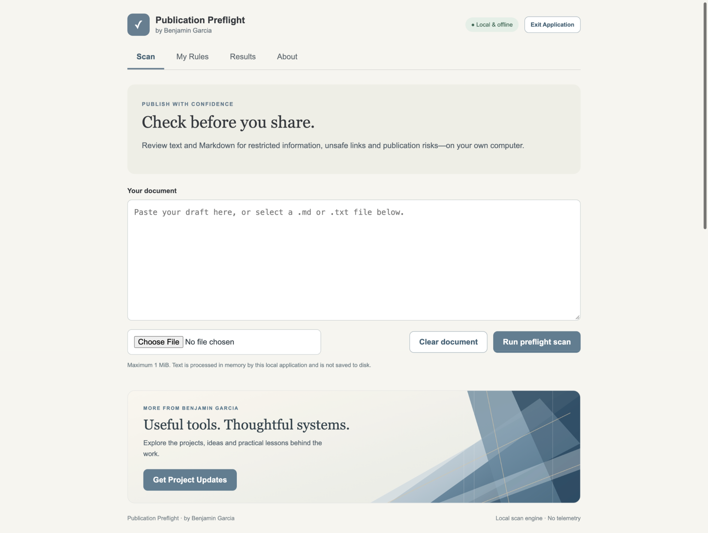

# Publication Preflight

Publication Preflight is a free, MIT-licensed, open-source offline tool for checking text and Markdown before publication. It looks for common publishing risks and information that you explicitly mark as restricted. Its browser-based interface runs locally on your computer.

Scanning does **not** guarantee that content is safe to publish. Always review important documents yourself.

**[Download Publication Preflight v1.0.0](https://github.com/benjamingarcia-labs/publication-preflight/releases/tag/v1.0.0)** · [Project overview](https://benjaminjgarcia.com/projects) · [Get email updates](https://benjaminjgarcia.com/updates)



## Who it helps

For writers and developers preparing text or Markdown for public sharing. Use it to catch restricted phrases, private domains, unresolved wiki links, and other supported publishing risks before your final review. It runs locally without sending your draft to an external service.

## Requirements

- Windows x64 or macOS on Apple silicon (ARM64) for the v1.0.0 packaged downloads; no Intel Mac package is provided
- A modern web browser
- No online account or Python installation for packaged releases

## Start the application

1. Download the **Windows** or **macOS** application ZIP from the [v1.0.0 release page](https://github.com/benjamingarcia-labs/publication-preflight/releases/tag/v1.0.0). The automatically generated source-code archives are for developers.
2. Extract the downloaded ZIP.
3. On Windows, double-click `PublicationPreflight.exe`. On macOS, open `PublicationPreflight.app`.
4. The application opens in your default browser.
5. Select **Exit Application** when finished, or close the application tab. The local service automatically stops after approximately 60 seconds without browser activity.

**Installation notice:** These apps are not signed with a trusted publisher certificate; the Mac app is not notarized. Your operating system may show a security warning. Read the release notes and checksums before installing.

The application listens only on `127.0.0.1` (your own computer).

### Run from source (developers)

The source version requires Python 3.11 or newer. From the application directory run:

```bash
python3 -m preflight
```

### Build a native application (developers)

On the target Windows or macOS system, install PyInstaller in a build environment, then run:

```bash
python3 build.py
```

The build creates a Windows executable or macOS app bundle in `dist/`. Windows and macOS builds must run on their respective operating systems. Packaged releases should be tested on actual target systems before distribution.

## Use the scanner

1. Open **My Rules** to add blocked domains or protected phrases. Rules save automatically on your computer and can be edited or removed.
2. Open **Scan** and paste text, or choose a UTF-8 `.md`, `.markdown`, or `.txt` file.
3. Select **Run preflight scan**.
4. Open **Results** to review findings by line number and rule. Findings do not reproduce the matching protected text.
5. Select **Clear document** to remove the entered text, selected file, and displayed findings from the interface.

The scanner accepts up to **1 MiB** of text per scan.

### Example: check a Markdown draft

Add `internal.example.com` as a blocked domain, then scan a draft containing a link to that domain. Review the flagged line, remove or replace the private link, and scan again. This is a fictional example; use your own rules and review the full document before publishing.

## What it checks

Built-in checks include:

- Unencrypted HTTP URLs, local URI schemes, local hostnames, and nonpublic IP addresses
- Credentials embedded in URLs
- Unresolved wiki-style links
- Certain potentially unsafe embedded HTML elements
- Patterns that may indicate a credential assignment

Custom rules support:

- **Protected phrase:** a case-insensitive literal word or phrase
- **Blocked domain:** a hostname and its subdomains, such as `internal.example.com`

The scanner does not currently support custom regular expressions, PDF or Word documents, or entire-folder scans. It may miss obfuscated or unusually encoded sensitive information.

## Privacy and storage

- Document contents are processed in memory. The application does not save uploaded documents, scan results, or scan history to disk.
- Saved protection rules are stored separately in a local `rules.json` file under the user's `.publication-preflight` directory. These values may be sensitive, so protect your computer and account accordingly.
- The application does not send document text or saved rules to an external service.
- Your browser or operating system may independently retain temporary data or form state. Use **Clear document** when finished, especially when processing sensitive information.
- External website links open only when you choose to follow them.

## Run automated tests

From the application directory:

```bash
python3 -m unittest discover -s tests -v
```

## Troubleshooting

- **The browser did not open:** Check that a default browser is configured, then relaunch the app. If the issue continues, report your operating-system and browser versions.
- **The app remains running briefly:** After its browser tab closes, the local process normally exits within approximately 60 seconds. For immediate shutdown, select **Exit Application** before closing the tab. Browser background-tab throttling can occasionally stop the process even when a tab remains open; relaunch the app if that happens.
- **Rules do not save:** Confirm that your user account can write to its local configuration directory.
- **A file does not load:** Confirm that it is UTF-8 text and no larger than 1 MiB.
- **A scan reports no issues:** That means none of the currently configured checks matched; it is not a certification of publication safety.

## Help and feedback

[Report a bug or suggest an improvement](https://github.com/benjamingarcia-labs/publication-preflight/issues). Include your operating system, browser, and steps to reproduce. Do not post sensitive documents, protection rules, credentials, or private links in public issues.

[More tools and articles by Benjamin Garcia](https://benjaminjgarcia.com/) · [Email updates](https://benjaminjgarcia.com/updates)

---

```text
+--------------------------------------------------+
|                                                  |
|             PUBLICATION PREFLIGHT                |
|                                                  |
|              Created by Benjamin Garcia          |
|              benjaminjgarcia.com                 |
|                                                  |
+--------------------------------------------------+
```
